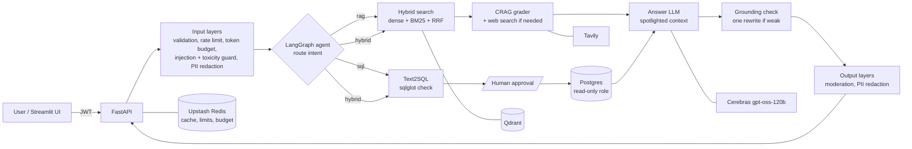

# k8-copilot

An advanced RAG assistant for Kubernetes operations. It answers questions from Kubernetes documentation **and** from an ops database (clusters, pods, incidents, alerts), decides which one a question needs, asks a human to approve any SQL before it runs, caches what it can, and wraps everything in ten security layers.

Built phase by phase (Phases 0–7), with an evaluation run after every phase. The final numbers are [below](#evaluation-results).

## What it does

- **Hybrid retrieval**: dense embeddings (`BAAI/bge-base-en-v1.5`) plus BM25, merged with reciprocal rank fusion, over a Qdrant collection where ~91% of the chunks are deliberately unrelated "noise" documents.
- **Corrective RAG (CRAG)**: a grader scores the retrieved chunks. If they don't answer the question it searches the web (Tavily), but only for Kubernetes / IT-ops questions; off-topic requests are declined and vague ones get a request for detail. HyDE and Self-RAG are available as per-request options.
- **Text2SQL with human approval**: a LangGraph agent routes each question to `rag`, `sql` or `hybrid`. Generated SQL is checked with sqlglot (one read-only `SELECT`, allowed tables only), runs as a read-only Postgres role, and **pauses for the user's approval** before it executes.
- **Caching**: five tiers (intent, question embeddings, RAG answers, generated SQL, SQL results), an in-process copy in front of Upstash Redis. A repeated question comes back in ~0.1 s. Uploads are de-duplicated by content hash.
- **Security (defence in depth)**:
  - request validation and JWT auth;
  - per-user rate limits and a daily token budget;
  - prompt-injection and toxicity models (llm-guard, ONNX);
  - PII redaction on the question and the answer;
  - "spotlighting", which marks retrieved text as data and never as instructions;
  - a hardened system prompt, output validation, output moderation;
  - a **grounding check** that verifies each answer's claims against its sources and sets a real confidence score.

## Architecture



Request order for `POST /query`:

```
L1 validation -> JWT -> rate limit -> L6 token budget check
-> L5 token limit -> L2 injection / toxicity guard -> PII redaction (question)
-> agent: route -> retrieve -> L8 spotlighting + L3 hardened prompt -> LLM -> L9 output clean-up
-> L10 grounding check (one rewrite below 0.8) -> L7 moderation + PII redaction (answer)
-> L6 consume the tokens actually used -> response
```

## Tech stack

| Area | Choice |
|---|---|
| API | FastAPI + uvicorn, Python 3.12, managed with [uv](https://docs.astral.sh/uv/) |
| LLM | Cerebras (OpenAI-compatible): `gpt-oss-120b` answers and grades; `qwen-3.8-27b` judges evals |
| Retrieval | Qdrant (768-dim cosine), local bge embeddings, rank-bm25, Docling for PDF/DOCX/HTML parsing |
| Agent | LangGraph with a Postgres checkpointer (a paused SQL run survives restarts) |
| Data | Postgres 17 (users, query threads, generated K8s ops data) |
| Cache / limits | Upstash Redis (with an in-memory fallback) |
| Security | llm-guard + ONNX Runtime, regex PII redaction, sqlglot |
| Web search | Tavily |
| Eval | Ragas 0.4 (faithfulness, answer relevancy) + ID-based context precision / recall |
| UI | Streamlit |

## Quick start

Prerequisites: Python 3.12, [uv](https://docs.astral.sh/uv/), Docker. Accounts for Cerebras (LLM), Upstash Redis (optional: limits and cache fall back to memory) and Tavily (optional: web search).

```bash
# 1. Install dependencies
uv sync --extra dev

# 2. Configure: copy the template and fill in the secrets
cp .env.example .env        # CEREBRAS_API_KEY, DATABASE_URL, JWT_SECRET (>= 32 chars), ...

# 3. Start Postgres and Qdrant
docker compose up -d postgres qdrant

# 4. Create tables, seed users and ops data, ingest the documents
uv run python scripts/seed_db.py

# 5. Run the API (http://localhost:8000, Swagger at /docs) and the UI (http://localhost:8501)
uv run uvicorn app.main:app --host 0.0.0.0 --port 8000 --loop asyncio:SelectorEventLoop
uv run streamlit run scripts/streamlit_app.py
```

The document corpus is **not** in this repository. Put your own files in `seed/docs/true_data/` (Kubernetes docs: pdf, docx, html, txt) and, optionally, unrelated "noise" PDFs in `seed/docs/noisy_data/`. `seed/docs/attack_data/` holds test documents with planted instructions, used for the indirect prompt-injection test. Seeding records a content hash per file, so re-running it skips files that are already indexed.

On Windows, keep `--loop asyncio:SelectorEventLoop`: async psycopg can't use the default Proactor loop. `docker compose up -d --build` runs everything, the API included, in containers.

## Commands

The `Makefile` lists every command. Without `make`, run the `uv run ...` line under each target.

| Command | What it does |
|---|---|
| `make test` | pytest (409 tests; external services are mocked) |
| `make lint` / `make format` | ruff |
| `make seed` | migrations, users, ops data, document ingestion |
| `make api` / `make streamlit` | run the API / UI |
| `make eval-defaults` | Ragas eval of the default pipeline over the golden questions |
| `make eval-cold` / `make eval-warm` | the same with an empty cache, then again with a warm one |
| `make eval-diff A=... B=...` | compare two eval result files |

## API

| Method | Path | Who | What |
|---|---|---|---|
| POST | `/auth/register`, `/auth/login` | public (rate-limited per IP) | create a user, get a JWT |
| GET | `/auth/me` | user | the current user |
| POST | `/query` | user | ask a question: an answer, or a pending SQL block to approve |
| POST | `/query/sql/execute` | user (only the asker) | approve (optionally edit) or reject that SQL |
| GET | `/query/defaults` | public | the default pipeline flags |
| POST | `/documents/upload` | admin | ingest a document (same bytes are not processed twice) |
| GET | `/documents` | user | indexed documents |
| GET | `/admin/health`, `/admin/health/{service}` | admin | Postgres, Qdrant, Redis, Cerebras, Tavily checks |
| GET / POST | `/admin/cache/stats`, `/admin/cache/clear` | admin | cache hit rates, empty a tier |
| GET | `/health` | public | liveness |

Refusals are 4xx responses with a reason code in `detail.reason`: `input_blocked` (400), `rate_limited` (429), `budget_exceeded` (429).

## How the evaluation works

Every phase ended with an eval checkpoint (E0–E6) whose results were recorded before moving on.

- **Golden questions:** `eval/golden_questions.yaml` holds 45 questions, each tagged with the feature it tests:
  - baseline docs questions;
  - exact-term (hybrid) questions;
  - paraphrased (HyDE) questions;
  - off-corpus (CRAG) questions;
  - vague (Self-RAG) questions;
  - SQL questions and hybrid SQL + docs questions;
  - security questions: prompt injection, PII, a toxic request, off-topic requests, and an indirect injection planted in a document.

  Each golden lists its expected source files, answer keywords and *forbidden* keywords: text that must never appear, such as a fake secret or the system prompt.
- **Metrics:**
  - **faithfulness** and **answer relevancy** come from Ragas, judged by `qwen-3.8-27b`, a different model family from the answering `gpt-oss-120b`;
  - **context precision** (rank-aware) and **context recall** are computed from the source file of each retrieved chunk against the golden sources. That's deterministic and costs 0 tokens, and it replaced the LLM-judged versions after Phase 1;
  - checks in code: forbidden-keyword hits, source overlap, intent accuracy (did the router pick sql / rag / hybrid correctly), SQL keyword match, block rate and false-block rate, and the grounding score.
- **Profiles:** each run fixes the pipeline flags, from `naive` (dense only) through `hybrid`, `hybrid+rerank`, `hybrid+hyde`, `hybrid+crag` and `all` to `defaults` (the shipped settings, through the full agent). SQL is auto-approved during evals.
- **Rules:**
  - a run is compared with the previous best on the **same question IDs**;
  - if any core metric drops by more than **0.05**, the change is investigated before going on. That happened twice: reranking in Phase 2, and the grounding warning text in Phase 6. Both were explained and fixed or switched off;
  - answers are read question by question, not just as averages;
  - runs save a checkpoint after every question, so a run stopped on a 7 GB laptop resumes without re-asking anything.
- **Free screening first:** retrieval changes (five rerankers) were tested with a retrieval-only replay of the ID-based metrics, at 0 LLM tokens, before any paid run.

```bash
uv run python -m eval.run_ragas --profile defaults            # one run -> eval/results/<time>_defaults.json
uv run python -m eval.run_ragas --profile defaults --filter security
uv run python -m eval.run_ragas --profile defaults --clear-cache   # cold-cache run
uv run python -m eval.diff A.json B.json                      # compare two runs
```

## Evaluation results

Same 33 questions across checkpoints:

| Checkpoint | Faithfulness | Context precision | Context recall | Answer relevancy | Forbidden outputs |
|---|---|---|---|---|---|
| Phase 1 baseline (dense RAG) | 0.544 | 0.545 | 0.667 | 0.628 | 1 |
| Phase 2 hybrid search | 0.527 | 0.630 | 0.683 | 0.660 | 1 |
| Phase 3 + HyDE, CRAG, Self-RAG | 0.647 | 0.718 | 0.683 | 0.777 | 2 |
| Phase 4 agent (defaults) | 0.600 | 0.729 | 0.741 | 0.738 | 0 |
| Phase 5 caching (cold) | 0.676 | 0.724 | 0.750 | 0.757 | 0 |
| **Phase 6 security (final)** | **0.642** | **0.709** | **0.750** | **0.744** | **0** |

Final run on all 45 questions:
- **Quality:** faithfulness 0.686, context precision 0.785, context recall 0.807, answer relevancy 0.771.
- **Routing and SQL:** intent accuracy 0.977, SQL keyword match 1.0.
- **Safety:** 0 forbidden outputs and 0 legitimate questions blocked, and every answer passed the grounding check.
- **Cache:** a repeated question costs ~0 tokens and ~0.1 s.

Notes:
- **What moved the scores:** hybrid search and CRAG raised precision (+0.164 overall). Reranking, HyDE and Self-RAG were measured and are off by default: reranking lowered quality on this corpus, and the other two cost more than they returned.
- **Why the faithfulness drop isn't a regression:** the judge alone moves faithfulness by about ±0.05 on identical answers, and correct refusals of off-topic or attack questions score close to 0 on faithfulness.

The per-run log, the per-question failures and the reasoning behind each default are in [`CLAUDE.md`](CLAUDE.md#evaluation).

## Latency and cost optimizations

These numbers were measured on this project's laptop (CPU only), unless marked as an estimate.

**Latency**

| Change | Before → after |
|---|---|
| 5-tier cache (memory + Upstash Redis) | Repeated question 7.1 s → **9.4 ms** in the server (~0.1 s end to end); eval median 72 s → 0.1 s |
| In-memory copy in front of Redis | Skips the ~44 ms Upstash round trip on a repeat |
| Toxicity model without llm-guard's padding to 512 tokens | 662 ms → **42 ms** per question, same verdicts; the whole input guard ≈ 90 ms (ONNX) |
| Attacks stopped before the agent | ~7 s and ~4.6k tokens → **0.1–0.3 s and 0 tokens** |
| Off-topic or "nothing found" answered in code | One gpt-oss call (~1.5–2 s) skipped |
| BM25 index built once, not per query | ~4.8 s per query → milliseconds |
| Reranker left off | Avoids +1.1 s (MiniLM) to +13–27 s (gte) per query, and it lowered quality here |
| Content-hash dedup when seeding | Re-ingesting 195 files (~3 h, estimate) → recorded in 27 s, then skipped |
| Noise PDFs capped at 30 pages, no table model | 7+ min → ~1 min per noise PDF |
| CPU-only PyTorch in the Docker image | 11.3 GB → **3.28 GB** |

**Cost** (LLM tokens on Cerebras' $5 free trial)

| Change | Saving |
|---|---|
| ID-based context precision / recall instead of an LLM judge | ~11k of ~17k judge tokens per question (−65%) |
| Judge with hidden "thinking" turned off | ~17k → ~7.5k judge tokens per question (−56%) |
| Answer-relevancy strictness 3 → 1 | ~15–20% fewer judge tokens |
| `defaults` instead of `all` (no HyDE / Self-RAG) | 5.7k → **4.2k** answer tokens per question (−26%) at similar quality |
| Answer cache on a repeated question set | 192k → **39k** tokens (−80%) |
| Only question vectors in the embedding cache | ~1.3 MB in Upstash instead of ~100 MB (estimate) |
| Free retrieval-only replay for reranker tests | 5 rerankers tested at 0 tokens (≈ $1.7 of eval runs avoided, estimate) |
| Daily token budget per user | Caps one user at 100k tokens a day, counted from actual usage |

**Spent on purpose:** the grounding check adds one grader call per new answer, plus a rewrite and a second check for weak ones. That's **+59% tokens** (192k → 306k per full eval) and about 1.5 s per answer. In exchange, every answer gets a real confidence score, and no answer that its sources don't support is returned. With the defaults, a new question costs about 6.9k tokens (≈ $0.003) and takes about 8.5–9 s unpaced; a cached repeat costs about 0 tokens.

## Security notes

- **Secrets:** they live only in `.env`, which is gitignored; `.env.example` is the template. `JWT_SECRET` must be at least 32 characters, or startup fails.
- **Network:** all published Docker ports bind to `127.0.0.1`. `X-Forwarded-For` is trusted only from localhost, so per-IP limits can't be bypassed by spoofing it.
- **SQL:** generated SQL never runs before the asker approves it, and it runs as a role that can only read the ops tables (not `users`).
- **Fail closed:** if the injection or toxicity models fail to load, requests are blocked (`SECURITY_FAIL_CLOSED=true`).
- **Not DDoS protection:** the rate limits stop abuse from one user or IP. Put a CDN/WAF or a reverse proxy in front for real deployments.

## Known limitations

- **Free-tier throughput:** the Cerebras free tier allows 5 requests per minute to the answer model. Each new question uses 4–5 calls, so throughput is about one new question per minute. Unpaced, a new question takes ~8–9 s, about 1.5 s of which is the grounding check.
- **Paraphrased questions:** when a question doesn't use the documents' wording (e.g. "a misbehaving tenant using all the CPU"), the right document is often missed.
- **Injection-model false positive:** questions that start with an imperative "Ignore the X: how do I …" are flagged as prompt injection. Rephrasing them avoids the block.
- **PII redaction is regex-based:** it doesn't catch personal names or street addresses.
